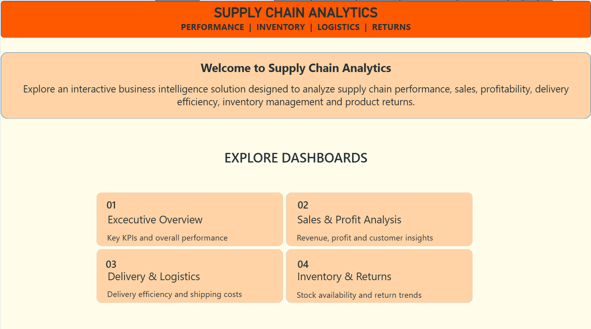
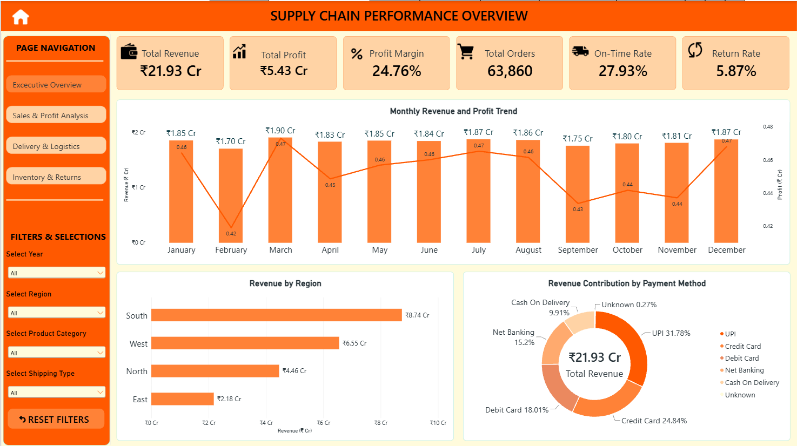
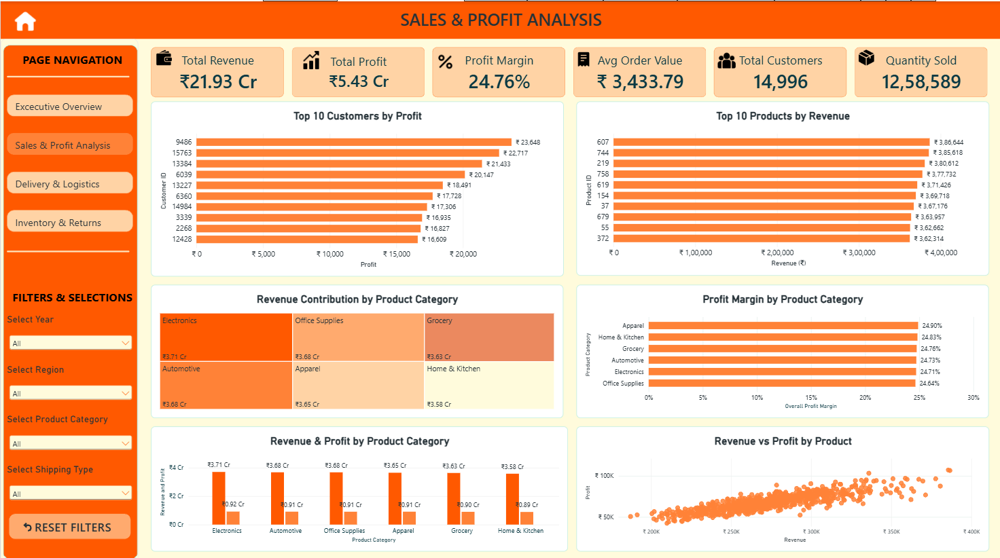
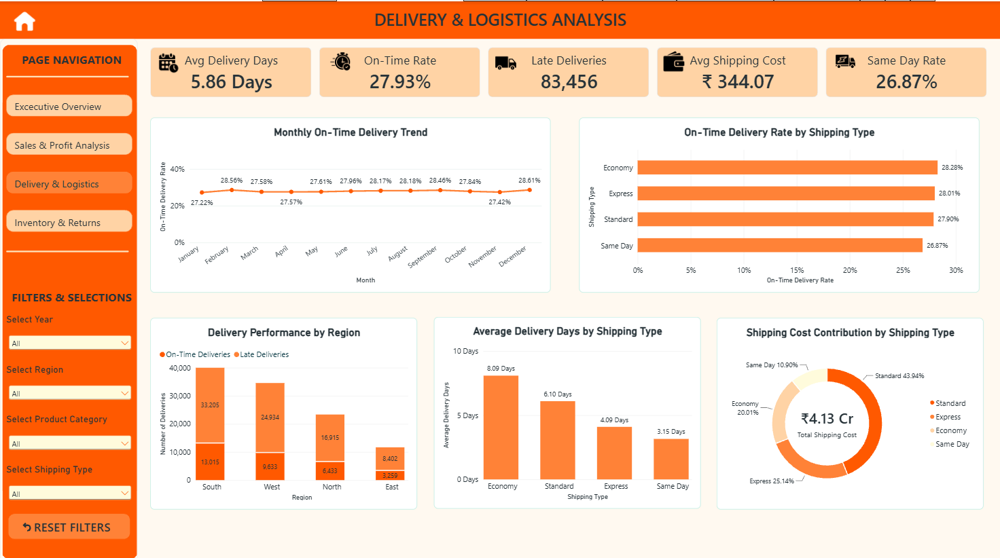
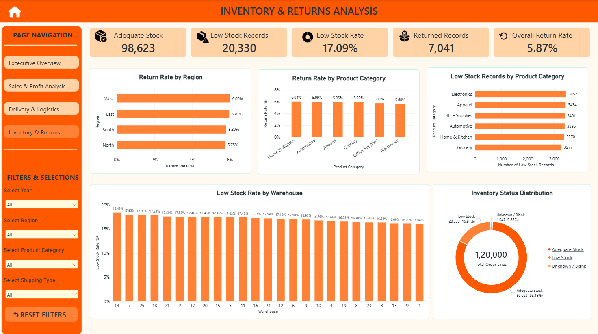

# Supply Chain Performance, Inventory & Logistics Analytics

An end-to-end Data Analyst portfolio project analyzing supply chain operations using **Microsoft Excel, MySQL, Python, and Power BI**.

The project explores sales performance, profitability, delivery efficiency, inventory availability, and product returns using a dataset containing 1,20,000 order-line records.

---

## Project Overview

**Project Title:** Supply Chain Performance, Inventory & Logistics Analytics

**Domain:** Supply Chain Analytics

**Dataset Size:** 1,20,000 records

**Date Range:** January 2024 – December 2025

**Tools Used:**
- Microsoft Excel
- MySQL Workbench
- Python
- Pandas
- NumPy
- Matplotlib
- Power BI

## Business Objectives

- Analyze overall revenue, profit, and profit margins.
- Identify top-performing products, categories, customers, and regions.
- Evaluate delivery performance and shipping efficiency.
- Analyze inventory availability and low-stock patterns.
- Understand product return trends.
- Identify data-quality issues and validate analytical results.
- Build interactive dashboards to support business decision-making.

---

## Project Workflow

### 1. Excel – Data Cleaning & Initial Analysis

- Inspected and prepared the supply chain dataset.
- Cleaned and standardized data using Excel and Power Query.
- Identified missing, duplicate, and invalid values.
- Created calculated fields for business analysis.
- Developed Pivot Tables and charts to identify initial trends.

**Folder:** `01_Excel_Analysis/`

### 2. SQL – Data Analysis & Validation

- Imported the dataset into MySQL Workbench.
- Created raw, working, and cleaned tables.
- Performed data cleaning and transformation.
- Checked missing values, duplicates, and invalid records.
- Validated calculated financial and operational metrics.
- Wrote SQL queries to answer 20 business questions.

**Folder:** `02_SQL_Analysis/`

### 3. Python – Exploratory Data Analysis

- Loaded and inspected the dataset using Pandas.
- Performed data-quality checks.
- Analyzed delivery, sales, profit, inventory, and return patterns.
- Used NumPy for numerical operations.
- Created visualizations using Matplotlib.
- Identified important business trends and insights.

**Folder:** `03_Python_EDA/`

### 4. Power BI – Interactive Dashboard

Developed a multi-page interactive dashboard with KPI cards, charts, slicers, and navigation.

**Dashboard Pages:**

1. Home
2. Executive Overview
3. Sales & Profit Analysis
4. Delivery & Logistics Analysis
5. Inventory & Returns Analysis

**Folder:** `04_PowerBI_Dashboard/`

### 5. Project Documentation

Contains the overall project report, including the project objectives, workflow, tools, data-quality findings, business metrics, and recommendations.

**Folder:** `05_Project_Documentation/`

---

## Dashboard Previews

### 1. Home Page


### 2. Executive Overview


### 3. Sales & Profit Analysis


### 4. Delivery & Logistics


### 5. Inventory & Returns



## Key Performance Indicators

| KPI | Result |
|---|---:|
| Total Revenue | ₹21.93 Cr |
| Total Profit | ₹5.43 Cr |
| Overall Profit Margin | 24.76% |
| Total Orders | 63,860 |
| Average Delivery Days | 5.86 Days |
| On-Time Delivery Rate | 27.93% |
| Overall Return Rate | 5.87% |

*Values represent the overall dashboard results. Interactive filters may change the displayed values.*

---

## Key Business Insights

### Sales & Profitability
- Electronics generated the highest revenue among product categories.
- Apparel recorded the highest category profit margin at approximately 24.90%.
- UPI was the leading payment method by revenue.
- The South region generated the highest revenue.

### Delivery & Logistics
- Average delivery duration was approximately 5.86 days.
- Economy shipping recorded the highest on-time delivery rate at approximately 28.28%.
- Same Day shipping had the shortest average delivery duration at approximately 3.15 days.

### Inventory & Returns
- There were 20,330 low-stock records.
- Electronics had the highest low-stock record count among product categories.
- Warehouse 14 recorded the highest low-stock rate at approximately 18.43%.
- Home & Kitchen had the highest category return rate at approximately 6.04%.
- West recorded the highest regional return rate at approximately 6.00%.

---

## Repository Structure

```text

Supply-Chain-Analytics-Complete-Data-Analyst-Project/
│
├── 01_Excel_Analysis/
│   ├── Screenshots/
│   ├── Excel_Analysis_Workflow.md
│   └── Supply_Chain_Final_Dataset.csv
│
├── 02_SQL_Analysis/
│   ├── Sql_Screenshots/
│   ├── Sql_Validation_Outputs/
│   ├── SQL_Business_Analysis.pdf
│   └── Supply_Chain_SQL_Project.sql
│
├── 03_Python_EDA/
│   ├── notebooks/
│   ├── visuals/
│   ├── Screenshots/
│   └── PYTHON_EDA_WORKFLOW.md
│
├── 04_PowerBI_Dashboard/
│   ├── Dashboard_Previews/
│   ├── Screenshots/
│   ├── POWER_BI_WORKFLOW.md
│   └── Supply_Chain_Analytics_Dashboard.pbix
│
├── 05_Project_Documentation/
│   └── Supply_Chain_Analytics_Project_Report.md
│
└── README.md

```

---

## Skills Demonstrated

- Data Cleaning and Data Preparation
- Exploratory Data Analysis (EDA)
- SQL Queries, Joins, Aggregations and Data Validation
- Excel and Power Query
- Python with Pandas and NumPy
- Data Visualization
- Power BI Dashboard Development
- DAX Measures and Calculated Columns
- Business Analysis and Insight Generation
- Data Storytelling

---

## Project Outcome

This project demonstrates a complete data analytics workflow, from raw dataset preparation and data validation to exploratory analysis, business reporting, and interactive dashboard development.

It showcases the practical application of Excel, SQL, Python, and Power BI to transform raw supply chain data into meaningful business insights.

---

## Author

**Tatini Raghu Ram**  
B.Tech – Computer Science & Engineering
Aspiring Data Analyst

**Skills:** Excel | SQL(MySQL) | Python | Power BI | Tableau | Analytics

**Connect with me:**
- [LinkedIn](https://www.linkedin.com/in/raghuramtatini/)
- [GitHub](https://github.com/Raghu200596)

---

**Project Category:** Data Analytics Project  
**Tools:** Excel | MySQL | Python | Power BI  
**Dataset:** 1,20,000 Supply Chain Records